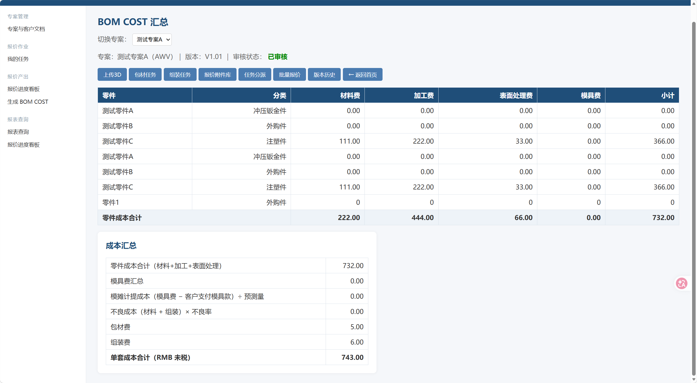
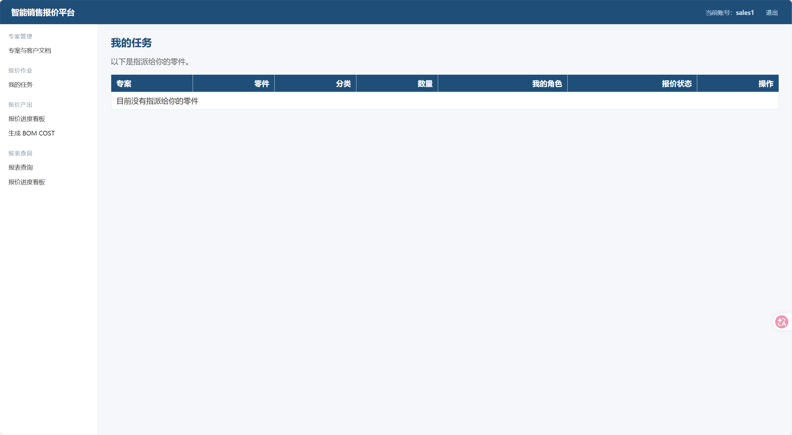
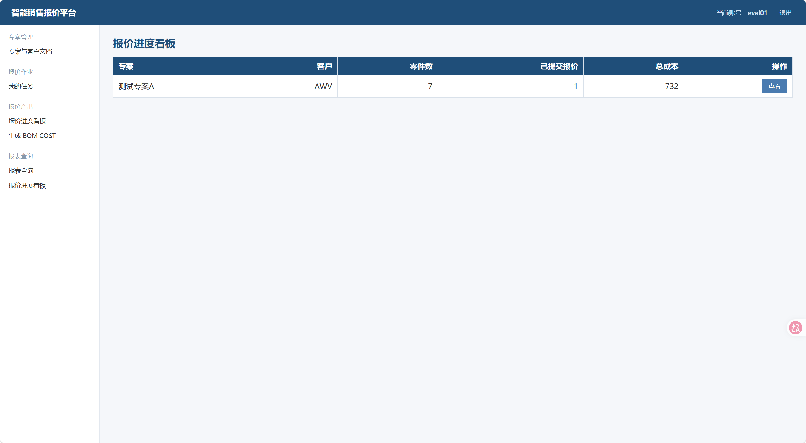
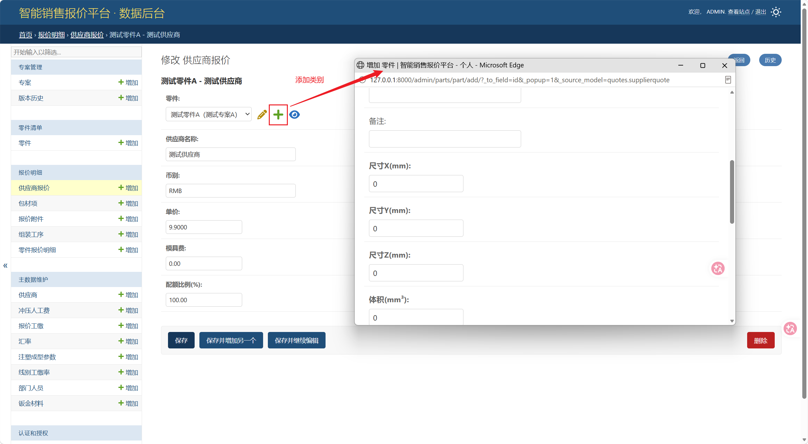
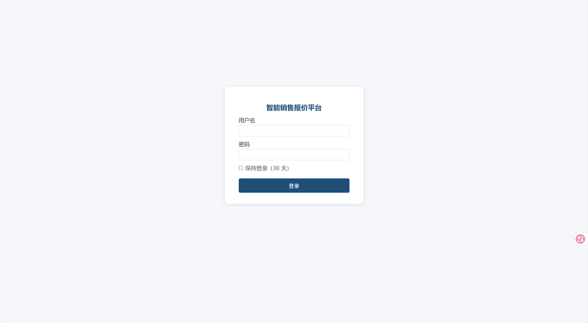

# 智能销售报价平台（简化版）

基于 Django 的报价平台，实现「专案 → 零件 → 报价 → BOM COST → 报价单」主链，并包含角色权限、任务分派、审批、版本管理、3D 解析。

## 界面预览

**BOM COST 汇总页**



**销售人员视角**（只看得到自己负责的专案）



**评估人员视角**（只看到指派给自己的任务）



**更多页面**






## 运行环境

- Python 3.11–3.14（原开发环境 3.14）
- Django 6.1.2
- openpyxl
- cadquery-ocp（OpenCascade，用于 3D 解析）

## 安装与启动

```cmd
uv sync
uv run python manage.py migrate
uv run python manage.py runserver
```

访问 http://127.0.0.1:8000/

> 如果 `cadquery-ocp` 下载太慢，可改用更小的 `cadquery-ocp-novtk`（省掉 77MB 的 VTK，解析功能完全一样）。

## 配置 SECRET_KEY（必做）

本项目**不把 SECRET_KEY 写在代码里**，首次运行前要创建 `.env`：

1. 复制 `.env.example` 为 `.env`
2. 把 `DJANGO_SECRET_KEY` 换成随机字符串，可以用下面的命令生成：

```cmd
python -c "from django.core.management.utils import get_random_secret_key; print(get_random_secret_key())"
```

`.env` 已被 `.gitignore` 忽略，**不会提交到仓库**。没有 `.env` 时会使用一个仅供本地调试的占位 key。

## 邮件通知（可选）

任务分派后会发通知邮件。默认走**控制台后端**——邮件内容直接打印在 `runserver` 窗口里，不需要任何配置。

要真正发到邮箱，在 `.env` 里填 QQ 邮箱的**授权码**：

```
EMAIL_HOST_USER=你的QQ邮箱
EMAIL_HOST_PASSWORD=QQ邮箱授权码
TASK_NOTIFY_EMAIL=收件邮箱
```

> 授权码不是登录密码：QQ邮箱 → 设置 → 账户 → 开启「SMTP 服务」→ 生成授权码。
> 填了授权码后会自动切到 `smtp.qq.com:465`（SSL）真实发信。

## 初始化演示数据

```cmd
uv run python seed_demo_data.py
```

会灌入一套 mock 主数据：汇率、5 家供应商、5 名部门人员、3 条报价工缴、4 种钣金材料（含密度与单价）、3 条线别工缴率、2 条冲压人工费、3 条注塑成型参数。**可重复运行**，不会重复插入。

## 功能清单

### 专案管理
- 专案基本信息、归属销售、包材/IE 负责人
- 主/子版本号自动递增
- 版本历史 + 报价快照 + 继承最近快照

### 零件与 3D
- 零件清单、Excel 导入 / **导出（含估价参数与自动估价结果）**
- **料号接入**：导出带「料号」列；导入带「料号」列时自动挂接 `ItemMaster`（顺便带出材质、按 ERP 分组推断零件分类）
- **上传 3D 图档（.stp/.step/.igs/.iges）→ OpenCascade 自动解析出零件的包围盒尺寸与体积，生成零件清单**
- **自动材料费**：`体积 × 密度 ÷ 10⁶ = 重量(kg)`、`重量 × 单价 = 材料费`；注塑件按 `单重 + 料头`
- **自动加工费**：
  - 冲压：`线别工缴率 × 工程数 × 人力 ÷ 时产 × (1 + 不良率)`
  - 注塑：`成型时间(S) ÷ 3600 × 工缴 ÷ 穴数`
  - NCT：读取零件的「NCT材料费 / NCT加工费」
- 不支持 .x_t（Parasolid 需商业引擎）

### 报价作业
- 任务分派页（5 个零件级角色 + 2 个专案级角色）
- **分派后自动发通知邮件**（未配 SMTP 时打印到控制台）
- 我的任务 / 我的零件 / 我的开模 / 我的模具采购 / 我的委外采购 / 我的数控加工
- 在线填写报价（材料费/加工费/表面处理费/模具费/委外加工费/委外表处费/NCT加工费）
- **「一键采用」自动估价**：把自动算出的材料费 + 加工费直接填进报价表
- 草稿 ↔ 已提交
- 批量下载报价模板 / 上传回填

### 报价产出
- BOM COST 完整公式：零件成本 + 模摊计提 + 不良成本 + 包材费 + 组装费
- **汇率读「汇率维护」表**：按当年、再按该币别最新一年取值，表里没有才回退到默认值；页面会标明汇率来源
- **未税折算**：模具费按含税录入，按专案的增值税率折算成未税后再摊提
- **报价单导出两种格式**：明细版（逐零件）、汇总版（各成本项）
- **看板**：完成度进度条、阻塞项（未指派 / 未报价）
- **专案代码自动编码**（`P2026-001`）、专案状态（进行中 / 已完成）一键切换
- **全部报价附件**：按专案分组浏览
- 多币别折算、审核流程
- 包材任务、组装任务、供应商多家比价、报价附件库
- 报表查询（BOM COST 查询 / 厂商询价报表）

### 系统维护（9 张主数据表 + ERP 同步）
供应商名录、部门人员、汇率维护、报价工缴、钣金材料、线别工缴率、冲压人工费、注塑成型参数、料号主数据（ERP）

> 演示数据：`uv run python seed_demo_data.py` 会灌入一套 mock 主数据（可重复运行）

## ERP 集成（一期主数据 + 二期第 1 批客户）

报价平台从金蝶 K/3 Cloud（星空）**单向**拉取主数据：汇率、供应商、料号（一期），客户（二期第 1 批，先对假 ERP 验证）。

架构上 **ERP 是既有的外部系统（黑盒），报价平台只是它的客户端**：

```
模拟ERP金蝶系统/                  ← 独立进程，扮演「公司用了 10 年的 ERP」，零依赖，端口 9900
      ▲  HTTP：ValidateUser（换 Cookie）+ ExecuteBillQuery（取二维数组）
智能销售报价系统-一期/erp/         ← 客户端 + 适配器 + 同步服务 + 调用日志
```

### 启动（两个终端）

```cmd
:: 1) 假 ERP（纯标准库，不需要 Django；双击 模拟ERP金蝶系统\启动模拟ERP.bat 最省事）
cd "E:\DeepSeekHarness\prodiction\模拟ERP金蝶系统"
启动模拟ERP.bat
:: 或者：uv run python manage.py erp_server（从项目侧启动）
:: 或者指定解释器："..\智能销售报价系统-一期\.venv\Scripts\python.exe" server.py
```

```cmd
:: 2) 同步
cd "E:\DeepSeekHarness\prodiction\智能销售报价系统-一期"
uv run python manage.py erp_sync --what=all
```

假 ERP 控制台 <http://127.0.0.1:9900/>：可查看/新增 汇率、供应商、料号、客户，还能「开启故障模拟」演示重试。

### 命令

| 命令 | 说明 |
|---|---|
| `manage.py erp_sync --what=all` | 一次同步 汇率 + 供应商 + 料号 + 客户 |
| `manage.py erp_sync --what=rates` | 只同步汇率（suppliers / items / customers 同理） |
| `manage.py erp_sync --test` | 只测连接，不同步 |
| `manage.py erp_server` | 从项目侧启动假 ERP（转调独立目录的 `server.py`） |

### 后台入口

- 页面：左侧「系统维护 → **ERP 主数据同步**」（`/erp/sync/`）—— 测连接、点按钮同步、看最近调用日志
- 日志：`/admin/erp/erplog/` —— 每次调用的报文摘要、错误、耗时
- 料号：`/admin/masterdata/itemmaster/` —— ERP 同步进来的料号，零件编辑时可挂料号
- 客户：`/admin/masterdata/customer/` —— ERP 同步进来的客户（编码/联系人/电话/结算币别/信用额度/启用状态）
- 零件清单**导出带「料号」列**；**导入时按「料号」列自动挂接**（没带料号的老文件仍按位置解析，向下兼容）；BOM COST 页也显示料号

### 自动化测试

```cmd
uv run python manage.py test erp      # 28 项：报文映射 / 幂等 upsert / 失败短路 / 页面权限 / 客户端脱敏
```

不联网、不依赖假 ERP 进程（用 `ERP_MODE=offline` 与内置假客户端）。

### 设计要点

- **全量 upsert，幂等**：重复同步不产生重复数据；ERP 里没有的本地数据不会被删除
- **首次对接认领**：供应商按「内码 → 编码 → 同名旧数据」匹配，手工维护过的供应商不会被插成两条
- **失败不崩**：重试 3 次、指数退避 1s/2s；连不上或 ERP 返回 500 都只友好报错，失败写入 `ErpLog`
- **换真 ERP 只改两处**：`.env`（地址/账号）+ 必要时 `erp/adapters/kingdee.py`（字段名）；业务代码、模型、页面不动

### 配置（`.env`）

```
ERP_MODE=mock            # mock=本机假 ERP / http=真金蝶 / offline=不联网读种子
ERP_BASE_URL=http://127.0.0.1:9900/K3Cloud
ERP_ACCT_ID=数据中心ID
ERP_USER=api_user
ERP_PASSWORD=api_password
ERP_TIMEOUT=30
ERP_MAX_ATTEMPTS=3       # 单次调用最多尝试几次
```

## 3D 解析说明

- 支持：`.stp` `.step` `.igs` `.iges`
- 解析内容：每个实体的包围盒尺寸（X/Y/Z，mm）、体积（mm³）
- 入口：BOM COST 页 →「上传3D」
- 解析出的零件分类默认「外购件」，可后续手动修改；零件名默认「零件1、零件2…」

## 目录结构

- `config/`      项目配置
- `projects/`    专案 + 版本历史
- `parts/`       零件 + 任务分派 + 尺寸/体积
- `quotes/`      报价、BOM COST、3D 解析（cad_parser.py）、模板
- `masterdata/`  主数据维护（含 ERP 同步来的料号 ItemMaster）
- `erp/`         ERP 集成：客户端、适配器、同步服务、管理命令、调用日志
- `templates/admin/` 后台自定义模板

> ERP 的模拟服务在**上一级目录** `模拟ERP金蝶系统/`（独立进程，不依赖 Django）。

## 升级注意

本次新增多个模型和字段，升级后务必执行：

```cmd
uv sync
uv run python manage.py migrate
```
